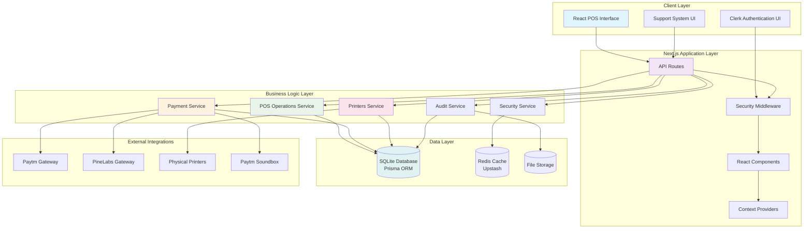
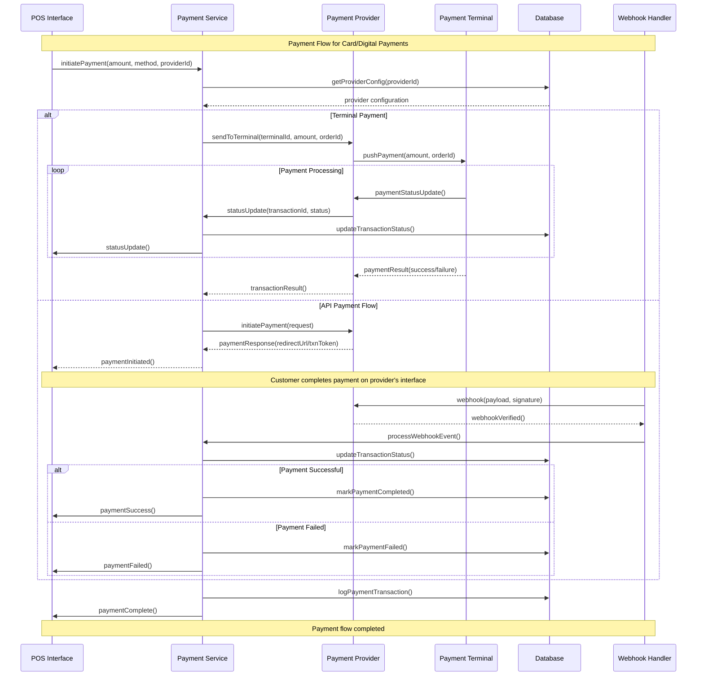
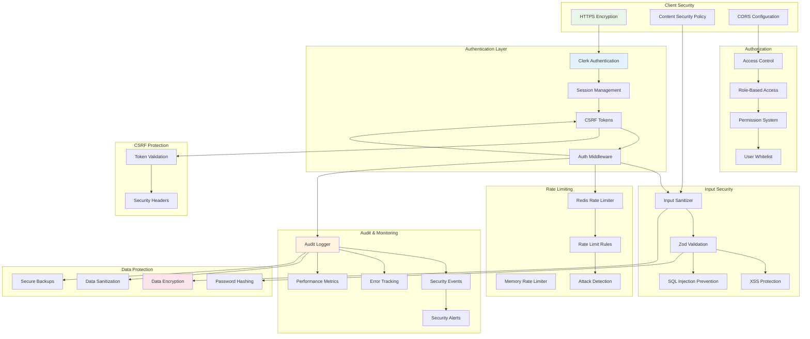
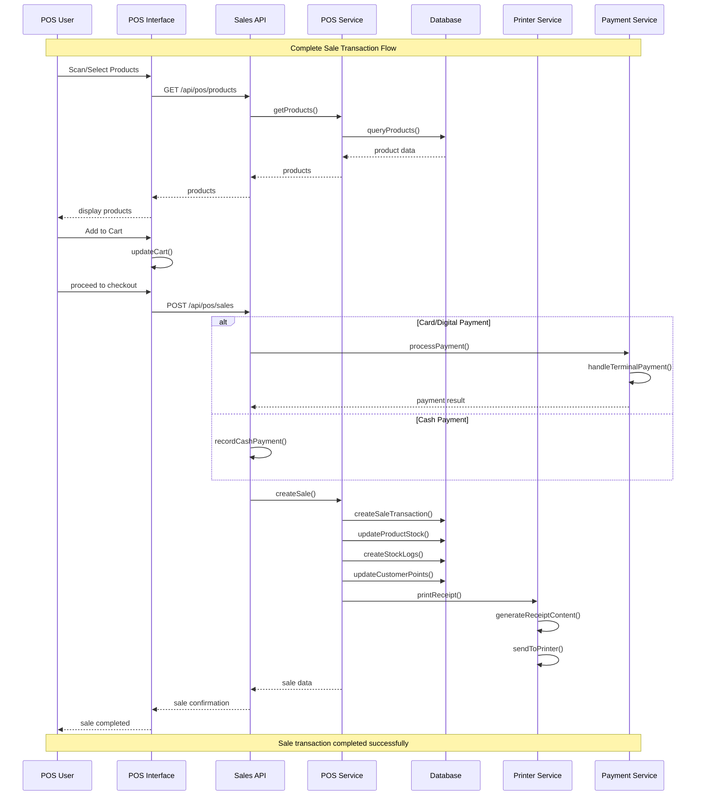
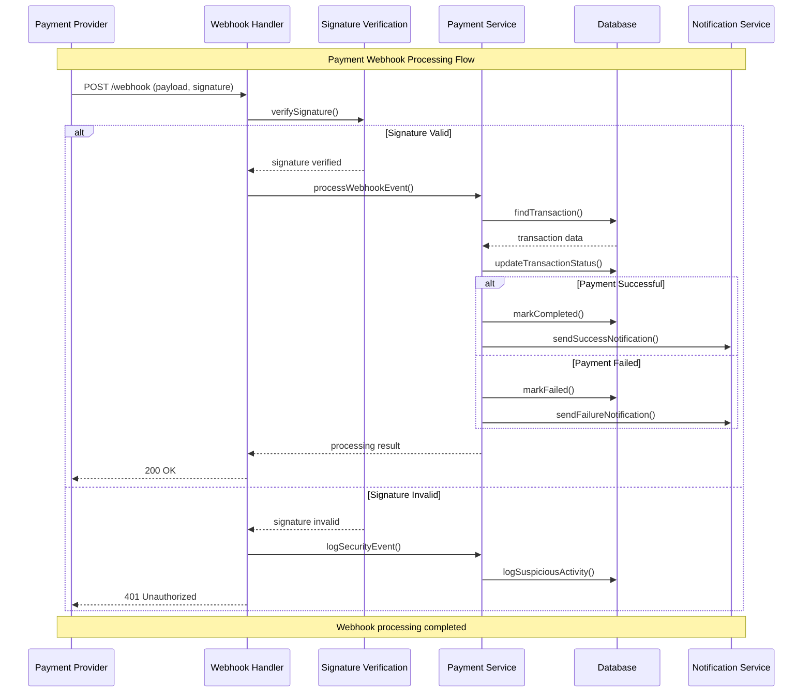
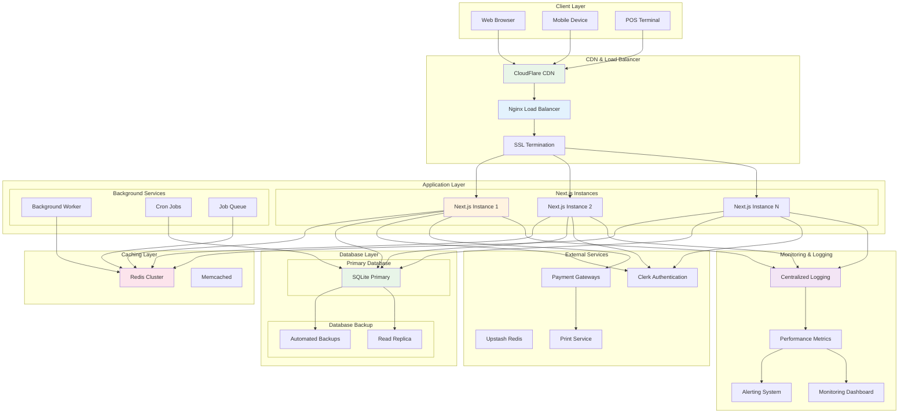

# POS System Architectural Diagrams

## Overview

This document contains comprehensive architectural diagrams for the Point of Sale (POS) system, providing visual representations of the system design, data flow, and component relationships.

## Table of Contents

1. [System Architecture Overview](#system-architecture-overview)
2. [Database Entity Relationship Diagram](#database-entity-relationship-diagram)
3. [API Architecture Diagram](#api-architecture-diagram)
4. [Component Hierarchy Diagram](#component-hierarchy-diagram)
5. [Payment Flow Diagram](#payment-flow-diagram)
6. [Security Architecture Diagram](#security-architecture-diagram)
7. [Data Flow Diagrams](#data-flow-diagrams)
8. [Deployment Architecture](#deployment-architecture)

---

## System Architecture Overview



---

## Database Entity Relationship Diagram

```mermaid
erDiagram
    %% Core Business Entities
    Store {
        string id PK
        string name
        string address
        string phone
        string email
        float gstRate
        string currency
        datetime createdAt
        datetime updatedAt
    }
    
    Category {
        string id PK
        string name
        string slug UK
        string color
        string storeId FK
        datetime createdAt
        datetime updatedAt
    }
    
    Product {
        string id PK
        string sku UK
        string barcode UK
        string name
        string description
        float price
        float cost
        int stock
        int minStock
        string categoryId FK
        string storeId FK
        string images
        boolean isActive
        datetime createdAt
        datetime updatedAt
    }
    
    Customer {
        string id PK
        string name
        string email UK
        string phone
        string address
        int points
        string storeId FK
        datetime createdAt
        datetime updatedAt
    }
    
    Employee {
        string id PK
        string clerkId UK
        string name
        string email UK
        string phone
        string role
        boolean isActive
        string storeId FK
        datetime createdAt
        datetime updatedAt
    }
    
    Sale {
        string id PK
        string invoiceNumber UK
        float subtotal
        float gst
        float discount
        float total
        string paymentMethod
        string status
        string notes
        string storeId FK
        string customerId FK
        string employeeId FK
        datetime createdAt
        datetime updatedAt
    }
    
    SaleItem {
        string id PK
        int quantity
        float price
        float subtotal
        string saleId FK
        string productId FK
        datetime createdAt
    }
    
    Payment {
        string id PK
        string saleId UK
        float amount
        string method
        string reference
        string status
        datetime createdAt
        datetime updatedAt
    }
    
    %% Payment System Entities
    PaymentProvider {
        string id PK
        string name
        string displayName
        string type
        boolean isActive
        string config
        string capabilities
        string storeId FK
        datetime createdAt
        datetime updatedAt
    }
    
    TerminalIntegration {
        string id PK
        string name
        string serialNumber
        string terminalId
        string model
        string status
        datetime lastHeartbeat
        string capabilities
        string settings
        string providerId FK
        datetime createdAt
        datetime updatedAt
    }
    
    PaymentTransaction {
        string id PK
        string transactionId
        string orderId
        float amount
        string currency
        string paymentMethod
        string status
        string providerStatus
        string customerInfo
        string responseData
        string failureReason
        float refundAmount
        string refundReason
        string terminalId FK
        string providerId FK
        string saleId FK
        datetime createdAt
        datetime updatedAt
        datetime completedAt
    }
    
    %% Printer System Entities
    Printer {
        string id PK
        string name
        string type
        string brand
        string model
        string connection
        string status
        boolean isDefault
        string settings
        string capabilities
        datetime lastConnected
        string storeId FK
        datetime createdAt
        datetime updatedAt
    }
    
    PrintJob {
        string id PK
        string type
        string content
        string status
        int priority
        int retryCount
        string error
        string printerId FK
        datetime createdAt
        datetime startedAt
        datetime completedAt
    }
    
    %% Audit and Security Entities
    AuditLog {
        string id PK
        datetime timestamp
        string userId
        string userEmail
        string action
        string resource
        string resourceId
        string method
        string path
        string ipAddress
        string userAgent
        string status
        string severity
        string details
        string previousValues
        string newValues
        string sessionId
        string correlationId
        datetime createdAt
    }
    
    SecurityEvent {
        string id PK
        datetime timestamp
        string eventType
        string severity
        string userId
        string userEmail
        string ipAddress
        string userAgent
        string path
        string method
        string description
        string details
        boolean resolved
        string resolvedBy
        datetime resolvedAt
        string prevention
        datetime createdAt
    }
    
    ErrorLog {
        string id PK
        datetime timestamp
        string level
        string type
        string message
        string data
        string userId
        string userEmail
        string sessionId
        string requestId
        string route
        string method
        string ipAddress
        string userAgent
        string source
        string environment
        string correlationId
        string stackTrace
        boolean isSensitive
        string tags
        string fingerprint
        string errorCode
        string userImpact
        boolean retryable
        boolean resolved
        datetime resolvedAt
        string resolvedBy
        datetime createdAt
        datetime updatedAt
    }
    
    %% Support System Entities
    SupportTicket {
        string id PK
        string ticketId UK
        string userId
        string userEmail
        string userName
        string title
        string description
        string category
        string priority
        string status
        string attachments
        string systemInfo
        string resolution
        string resolvedBy
        datetime resolvedAt
        string customerId
        string storeId
        datetime createdAt
        datetime updatedAt
    }
    
    KnowledgeBaseArticle {
        string id PK
        string title
        string slug UK
        string content
        string summary
        string category
        string tags
        boolean isPublished
        boolean isFeatured
        int viewCount
        int helpful
        int notHelpful
        string author
        datetime createdAt
        datetime updatedAt
    }
    
    ErrorReport {
        string id PK
        string reportId UK
        string userId
        string userEmail
        string title
        string description
        string errorType
        string severity
        string url
        string userAgent
        string browser
        string os
        string screenshot
        string stackTrace
        string consoleLogs
        string systemInfo
        string status
        string resolvedBy
        datetime resolvedAt
        string resolution
        datetime createdAt
        datetime updatedAt
    }
    
    %% Relationships
    Store ||--o{ Category : has
    Store ||--o{ Product : contains
    Store ||--o{ Customer : serves
    Store ||--o{ Employee : employs
    Store ||--o{ Sale : records
    Store ||--o{ Printer : manages
    Store ||--o{ PaymentProvider : integrates
    Store ||--o{ SupportTicket : receives
    Store ||--o{ StockLog : tracks
    
    Category ||--o{ Product : categorizes
    Product ||--o{ SaleItem : included_in
    Product ||--o{ StockLog : tracked_in
    
    Customer ||--o{ Sale : makes
    Employee ||--o{ Sale : processes
    Sale ||--o{ SaleItem : contains
    Sale ||--o{ Payment : requires
    Sale ||--o{ PaymentTransaction : has
    
    PaymentProvider ||--o{ TerminalIntegration : manages
    PaymentProvider ||--o{ PaymentTransaction : processes
    TerminalIntegration ||--o{ PaymentTransaction : executes
    
    Printer ||--o{ PrintJob : processes
    
    Employee ||--o{ StockLog : logs
    
    Customer ||--o{ SupportTicket : creates
```



---

## API Architecture Diagram

```mermaid
graph TB
    subgraph "Client Applications"
        POS_UI[POS Interface]
        Admin_UI[Admin Dashboard]
        Mobile[Mobile App]
    end
    
    subgraph "API Gateway Layer"
        NGINX[Nginx Load Balancer]
        RateLimit[Rate Limiting]
        Auth[Authentication]
    end
    
    subgraph "Next.js API Routes"
        subgraph "POS APIs"
            SalesAPI[/api/pos/sales]
            ProductsAPI[/api/pos/products]
            CustomersAPI[/api/pos/customers]
            EmployeesAPI[/api/pos/employees]
            CategoriesAPI[/api/pos/categories]
            StockAPI[/api/pos/stock]
        end
        
        subgraph "Payment APIs"
            PaymentsAPI[/api/pos/payments]
            ProvidersAPI[/api/pos/payments/providers]
            TerminalsAPI[/api/pos/payments/terminals]
            WebhooksAPI[/api/pos/payments/webhooks]
        end
        
        subgraph "System APIs"
            PrintersAPI[/api/pos/printers]
            LogsAPI[/api/pos/logs]
            SettingsAPI[/api/pos/store/settings]
            ReportsAPI[/api/pos/sales/stats]
        end
        
        subgraph "Support APIs"
            TicketsAPI[/api/support/tickets]
            KnowledgeAPI[/api/support/knowledge-base]
        end
        
        subgraph "Auth APIs"
            SyncAPI[/api/auth/sync-user]
        end
    end
    
    subgraph "Middleware Layer"
        Security[Security Middleware]
        Validation[Input Validation]
        CSRF[CSRF Protection]
        Audit[Audit Logging]
    end
    
    subgraph "Service Layer"
        POSService[POS Service]
        PaymentService[Payment Service]
        PrintService[Printers Service]
        AuditService[Audit Service]
        AuthService[Auth Service]
    end
    
    subgraph "Data Access Layer"
        Prisma[Prisma Client]
        Redis[Redis Client]
        FileSystem[File System]
    end
    
    %% Connections
    POS_UI --> NGINX
    Admin_UI --> NGINX
    Mobile --> NGINX
    
    NGINX --> RateLimit
    RateLimit --> Auth
    Auth --> Security
    
    Security --> Validation
    Validation --> CSRF
    CSRF --> Audit
    
    Audit --> SalesAPI
    Audit --> ProductsAPI
    Audit --> CustomersAPI
    Audit --> PaymentsAPI
    Audit --> PrintersAPI
    
    SalesAPI --> POSService
    ProductsAPI --> POSService
    CustomersAPI --> POSService
    EmployeesAPI --> POSService
    CategoriesAPI --> POSService
    StockAPI --> POSService
    
    PaymentsAPI --> PaymentService
    ProvidersAPI --> PaymentService
    TerminalsAPI --> PaymentService
    WebhooksAPI --> PaymentService
    
    PrintersAPI --> PrintService
    
    LogsAPI --> AuditService
    SettingsAPI --> AuthService
    ReportsAPI --> POSService
    
    SyncAPI --> AuthService
    
    POSService --> Prisma
    PaymentService --> Prisma
    PrintService --> Prisma
    AuditService --> Prisma
    AuthService --> Prisma
    
    AuditService --> Redis
    RateLimit --> Redis
    
    AuditService --> FileSystem
    
    style POS_UI fill:#e3f2fd
    style SalesAPI fill:#f3e5f5
    style PaymentService fill:#fff3e0
    style PrintService fill:#fce4ec
    style Prisma fill:#e8f5e8
```

---

## Component Hierarchy Diagram

```mermaid
graph TD
    %% Root Level
    Root[RootLayout]
    
    %% Provider Level
    subgraph "Providers"
        ClerkProvider[ClerkProvider]
        SettingsProvider[SettingsProvider]
        Toast[Toast Provider]
    end
    
    %% Layout Level
    subgraph "Layout Components"
        ClientLayout[ClientLayout]
        Footer[Footer]
        MainContent[Main Content Area]
    end
    
    %% POS Interface Level
    subgraph "POS System"
        POSInterface[POSInterface]
        
        subgraph "Product Management"
            ProductSearch[Product Search & Filter]
            ProductGrid[Product Grid Display]
            CategoryFilter[Category Filter]
        end
        
        subgraph "Shopping Cart"
            ShoppingCart[Shopping Cart]
            CartItem[Cart Item Component]
            QuantityControl[Quantity Controls]
        end
        
        subgraph "Checkout System"
            CheckoutDialog[Checkout Dialog]
            PaymentMethod[Payment Method Selection]
            TerminalSelection[Terminal Selection]
            PrinterSelection[Printer Selection]
        end
        
        subgraph "Receipt & Printing"
            ReceiptDialog[Receipt Dialog]
            PrintReceipt[Print Receipt]
            PrintInvoice[Print Invoice]
        end
    end
    
    subgraph "Management Interfaces"
        ProductsMgmt[ProductsManagement]
        CustomersMgmt[CustomersManagement]
        EmployeesMgmt[EmployeesManagement]
        SalesReport[SalesReport]
        SettingsPanel[SettingsPanel]
    end
    
    subgraph "Support System"
        SupportWidget[SupportWidget]
        SupportDialog[SupportDialog]
        ErrorReporter[ErrorReporter]
        HelpCenter[HelpCenter]
    end
    
    subgraph "UI Components"
        subgraph "Form Components"
            Input[Input Components]
            Select[Select Components]
            Button[Button Components]
            Dialog[Dialog Components]
        end
        
        subgraph "Layout Components"
            Card[Card Components]
            Table[Table Components]
            Tabs[Tab Components]
            Badge[Badge Components]
        end
        
        subgraph "Feedback Components"
            Toast[Toast Notifications]
            Progress[Progress Indicators]
            Alert[Alert Components]
        end
    end
    
    %% Connections
    Root --> ClerkProvider
    Root --> SettingsProvider
    Root --> ClientLayout
    
    ClientLayout --> Footer
    ClientLayout --> MainContent
    
    MainContent --> POSInterface
    MainContent --> ProductsMgmt
    MainContent --> CustomersMgmt
    MainContent --> EmployeesMgmt
    MainContent --> SalesReport
    MainContent --> SettingsPanel
    
    POSInterface --> ProductSearch
    POSInterface --> ShoppingCart
    POSInterface --> CheckoutDialog
    POSInterface --> ReceiptDialog
    
    ProductSearch --> ProductGrid
    ProductSearch --> CategoryFilter
    
    ShoppingCart --> CartItem
    CartItem --> QuantityControl
    
    CheckoutDialog --> PaymentMethod
    CheckoutDialog --> TerminalSelection
    CheckoutDialog --> PrinterSelection
    
    ReceiptDialog --> PrintReceipt
    ReceiptDialog --> PrintInvoice
    
    MainContent --> SupportWidget
    SupportWidget --> SupportDialog
    SupportDialog --> ErrorReporter
    SupportDialog --> HelpCenter
    
    %% UI Component Dependencies
    ProductSearch --> Input
    ProductSearch --> Select
    ShoppingCart --> Button
    CheckoutDialog --> Dialog
    ProductsMgmt --> Table
    CustomersMgmt --> Table
    EmployeesMgmt --> Table
    
    Toast --> Toast
    POSInterface --> Alert
    
    style RootLayout fill:#e1f5fe
    style POSInterface fill:#e8f5e8
    style PaymentService fill:#fff3e0
    style PrintService fill:#fce4ec
```



---

## Payment Flow Diagram



---

## Security Architecture Diagram



---

## Data Flow Diagrams

### Sale Transaction Flow



### Payment Webhook Flow



---

## Deployment Architecture



---

## Summary

These architectural diagrams provide a comprehensive visual representation of the POS system architecture, covering:

- **System Overview**: High-level architecture with all major components
- **Database Design**: Complete entity-relationship diagram with all tables and relationships
- **API Structure**: RESTful API organization and routing
- **Component Hierarchy**: React component structure and dependencies
- **Payment Flow**: Detailed sequence diagrams for payment processing
- **Security Architecture**: Multi-layered security implementation
- **Data Flows**: Sequence diagrams for key business processes
- **Deployment**: Production-ready deployment architecture

These diagrams serve as both documentation for the current architecture and a blueprint for future development and scaling efforts.

---

*Document Version: 1.0*  
*Created: 2025-12-26*  
*Total Diagrams: 8*