# POS System Architecture Analysis

## Executive Summary

This document provides a comprehensive analysis of the Point of Sale (POS) system architecture, examining the technical stack, system design, database structure, API organization, component hierarchy, integrations, and security implementation.

## Table of Contents

1. [Tech Stack Analysis](#tech-stack-analysis)
2. [System Architecture](#system-architecture)
3. [Database Schema Analysis](#database-schema-analysis)
4. [API Structure](#api-structure)
5. [Component Hierarchy](#component-hierarchy)
6. [External Integrations](#external-integrations)
7. [Security Implementation](#security-implementation)
8. [Key Architectural Decisions](#key-architectural-decisions)
9. [Strengths and Considerations](#strengths-and-considerations)

---

## Tech Stack Analysis

### Core Technologies

#### Frontend Stack
- **Framework**: Next.js 15.5.9 (App Router)
- **Language**: TypeScript 5.x
- **UI Library**: React 19.0.0
- **Styling**: TailwindCSS 4.x with shadcn/ui components
- **State Management**: Zustand 5.0.6
- **Forms**: React Hook Form 7.60.0 with Zod validation
- **Animations**: Framer Motion 12.23.2
- **Charts**: Recharts 2.15.4
- **Drag & Drop**: @dnd-kit/core 6.3.1

#### Backend Stack
- **Runtime**: Node.js with Next.js API Routes
- **Database**: SQLite with Prisma ORM 6.11.1
- **Authentication**: Clerk 6.36.5
- **Caching**: Upstash Redis 1.31.7
- **Validation**: Zod 4.0.2

#### Development Tools
- **Package Manager**: Bun (with lockfile support)
- **Linting**: ESLint 9
- **Build**: Next.js build system with standalone output
- **Type Safety**: TypeScript with strict configuration

### Supporting Libraries

#### Payment Processing
- **Paytm Integration**: Custom provider with Soundbox terminal support
- **PineLabs Integration**: Terminal-based payment processing
- **Payment Methods**: Card swipe, UPI, wallet, netbanking, EMI

#### Printing System
- **Thermal Printers**: ESC/POS protocol support
- **Inkjet Printers**: Standard printing with templates
- **Label Printing**: Product and shipping labels
- **Print Queue**: Job management system

#### Security Libraries
- **Input Sanitization**: isomorphic-dompurify
- **Rate Limiting**: express-rate-limit with Redis support
- **Audit Logging**: Winston logging framework
- **Error Tracking**: Comprehensive error aggregation system

---

## System Architecture

### High-Level Architecture

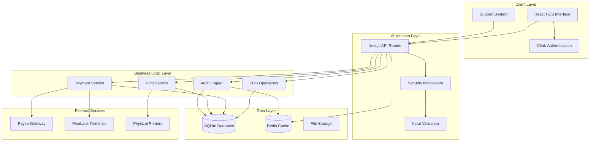

### Architectural Patterns

#### 1. Layered Architecture
- **Presentation Layer**: React components and UI
- **Application Layer**: API routes and middleware
- **Business Logic Layer**: Services and utilities
- **Data Layer**: Database and external services

#### 2. Service-Oriented Design
- `PaymentService`: Handles all payment processing
- `PrintersService`: Manages printing operations
- `AuditLogger`: Provides security logging
- `RateLimiter`: Implements rate limiting

#### 3. Repository Pattern
- Prisma Client as data access layer
- Centralized database connections
- Type-safe database operations

---

## Database Schema Analysis

### Core Entities

#### Business Entities
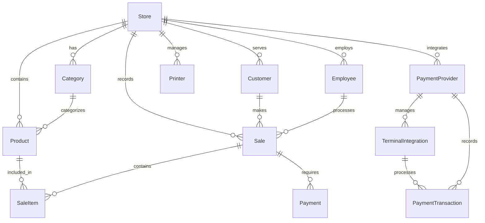

#### System Entities
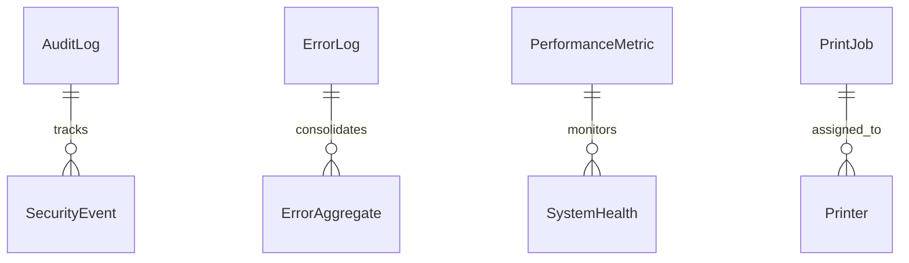

### Key Relationships

#### Store-Centric Design
- All business entities are scoped to a `Store`
- Enables multi-tenant architecture
- Clean separation of concerns

#### Payment Ecosystem
- `PaymentProvider` → `TerminalIntegration` → `PaymentTransaction`
- Supports multiple payment providers simultaneously
- Terminal status monitoring and management

#### Audit Trail
- Comprehensive logging of all system activities
- Security event tracking
- Performance monitoring integration

---

## API Structure

### RESTful API Organization

#### Endpoint Categories

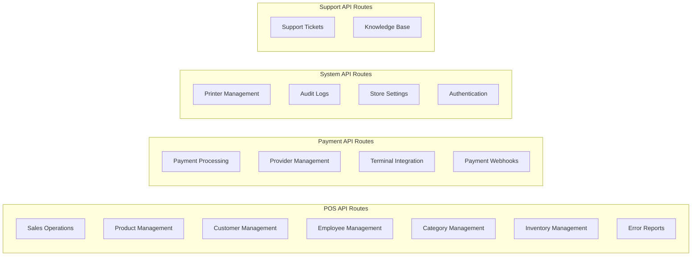

### API Design Principles

#### 1. Resource-Based URLs
```
/api/pos/sales           # Collection of sales
/api/pos/sales/{id}      # Specific sale
/api/pos/products        # Product catalog
/api/pos/customers       # Customer database
```

#### 2. HTTP Method Semantics
- `GET`: Retrieve resources
- `POST`: Create new resources
- `PATCH`: Update existing resources
- `DELETE`: Remove resources

#### 3. Response Structure
```json
{
  "success": true,
  "data": {},
  "error": null,
  "message": "Operation completed successfully"
}
```

### Security Middleware Integration

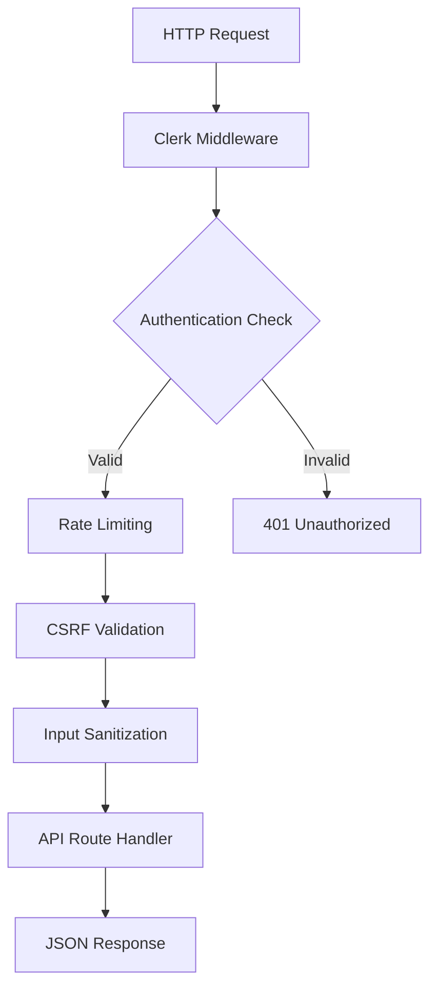

---

## Component Hierarchy

### React Component Architecture

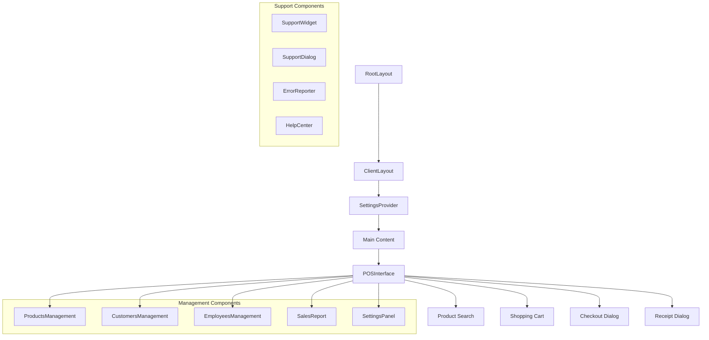

### Component Design Patterns

#### 1. Compound Components
- `POSInterface` orchestrates multiple sub-components
- Shared state management through context
- Modular and reusable design

#### 2. Provider Pattern
- `SettingsProvider`: Global application settings
- `ClerkProvider`: Authentication state
- `Toast`: Notification system

#### 3. Custom Hooks
- `useBarcodeScanner`: Hardware integration
- `useToast`: Notification management
- `useMobile`: Responsive design

### State Management

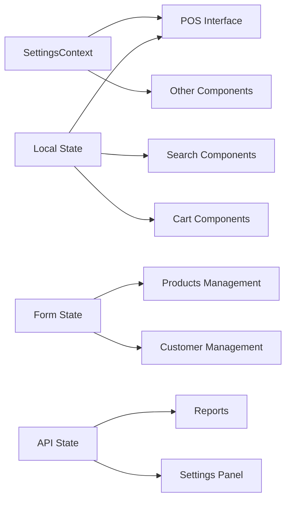

---

## External Integrations

### Payment Gateway Integration

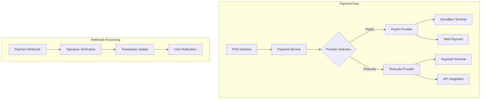

### Printer Integration

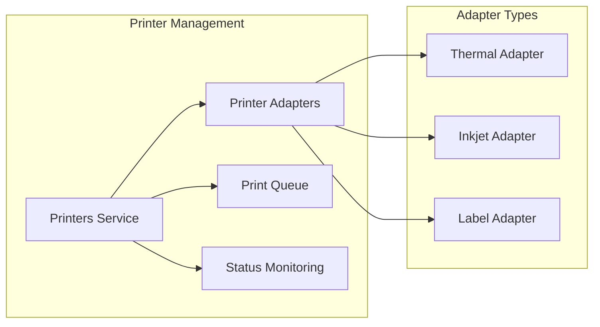

### Authentication Integration

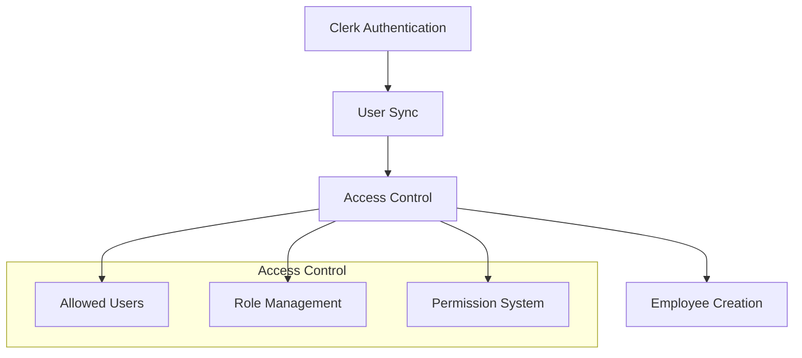

---

## Security Implementation

### Security Architecture

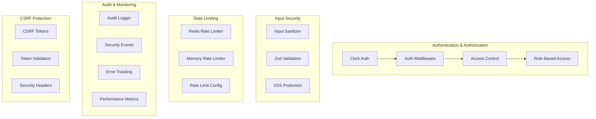

### Security Measures

#### 1. Authentication & Authorization
- **Clerk Integration**: Enterprise-grade authentication
- **Role-Based Access**: Admin, manager, staff roles
- **User Whitelisting**: Controlled access management
- **Session Management**: Secure session handling

#### 2. Input Validation & Sanitization
- **Zod Schema Validation**: Runtime type checking
- **DOMPurify**: XSS prevention
- **SQL Injection Prevention**: Parameterized queries
- **CSRF Protection**: Token-based validation

#### 3. Rate Limiting & DDoS Protection
- **Redis-backed Rate Limiting**: Distributed rate limiting
- **Memory Fallback**: Single-instance support
- **Configurable Limits**: Per-endpoint rate limiting
- **IP-based Blocking**: Automatic threat mitigation

#### 4. Audit & Compliance
- **Comprehensive Logging**: All user actions logged
- **Security Event Tracking**: Suspicious activity detection
- **Performance Monitoring**: System health metrics
- **Error Aggregation**: Centralized error management

### Security Headers Implementation

```typescript
const securityHeaders = {
  'X-Content-Type-Options': 'nosniff',
  'X-Frame-Options': 'DENY',
  'X-XSS-Protection': '1; mode=block',
  'Referrer-Policy': 'strict-origin-when-cross-origin',
  'Content-Security-Policy': "default-src 'self'"
}
```

---

## Key Architectural Decisions

### 1. Next.js App Router Architecture
**Decision**: Used Next.js 15.5.9 with App Router for full-stack development.

**Rationale**:
- Server-side rendering for better performance
- API routes for backend functionality
- Built-in optimization and caching
- TypeScript support throughout

### 2. SQLite with Prisma
**Decision**: Used SQLite as primary database with Prisma ORM.

**Rationale**:
- Zero-configuration setup
- Type-safe database operations
- Migration system
- Multi-platform compatibility

### 3. Clerk Authentication
**Decision**: Integrated Clerk for user management and authentication.

**Rationale**:
- Enterprise-grade security
- Session management
- User synchronization
- Compliance features

### 4. Layered Service Architecture
**Decision**: Implemented service layer for business logic.

**Rationale**:
- Separation of concerns
- Testable components
- Reusable functionality
- Clear data flow

### 5. Comprehensive Audit System
**Decision**: Built extensive audit and monitoring capabilities.

**Rationale**:
- Regulatory compliance
- Security monitoring
- Performance tracking
- Debug support

---

## Strengths and Considerations

### Architectural Strengths

#### 1. Comprehensive Feature Set
- **Complete POS Functionality**: Inventory, sales, customers, employees
- **Payment Integration**: Multiple payment providers and terminals
- **Printing System**: Multi-printer support with different types
- **Audit & Security**: Enterprise-grade logging and monitoring

#### 2. Modern Tech Stack
- **React 19**: Latest React features and performance
- **TypeScript**: Type safety throughout the application
- **Prisma**: Type-safe database operations
- **Next.js 15**: Modern full-stack framework

#### 3. Scalable Architecture
- **Modular Design**: Components and services are modular
- **Service Layer**: Clear separation of business logic
- **Database Design**: Normalized schema with proper relationships
- **API Structure**: RESTful design with consistent patterns

#### 4. Security-First Approach
- **Multi-layered Security**: Authentication, authorization, input validation
- **Rate Limiting**: DDoS protection and abuse prevention
- **Audit Trail**: Comprehensive activity logging
- **Input Sanitization**: XSS and injection prevention

#### 5. External Integrations
- **Payment Gateways**: Paytm and PineLabs integration
- **Printer Support**: Multiple printer types and protocols
- **Hardware Integration**: Barcode scanning support

### Areas for Consideration

#### 1. Database Scalability
**Current**: SQLite with single-tenant design
**Consideration**: For larger deployments, consider:
- PostgreSQL for better concurrency
- Multi-tenant architecture
- Database sharding strategies

#### 2. Deployment Architecture
**Current**: Single-instance deployment
**Consideration**: For production scaling:
- Containerization with Docker
- Load balancing
- Database clustering
- CDN integration

#### 3. Caching Strategy
**Current**: Redis for rate limiting
**Consideration**: Expand caching for:
- Product catalog caching
- Session storage
- API response caching
- Real-time updates

#### 4. Real-time Features
**Current**: Polling-based updates
**Consideration**: Implement WebSocket for:
- Live inventory updates
- Real-time notifications
- Multi-user synchronization
- Payment status updates

#### 5. Mobile Optimization
**Current**: Responsive design
**Consideration**: Native features:
- Offline functionality
- Push notifications
- Device-specific optimizations
- Hardware integration

---

## Conclusion

The POS system demonstrates a well-architected, modern application with comprehensive features and strong security foundations. The layered architecture, service-oriented design, and extensive integration capabilities provide a solid foundation for a retail POS solution.

The system successfully balances functionality with maintainability, offering both ease of use for end users and maintainability for developers. The security-first approach and comprehensive audit capabilities make it suitable for enterprise environments.

Key areas for future enhancement include scalability improvements, real-time features, and mobile optimization to meet evolving business requirements.

---

*Document Version: 1.0*  
*Analysis Date: 2025-12-26*  
*System Version: 0.1.0*